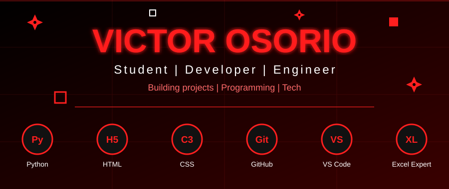

---

## ABOUT ME

I am a **technology student** who builds websites, programs in **Python**, and works on science and engineering projects. I am also an **Excel expert**.

---

## FEATURED PROJECTS

| Project | Description |
|:---:|:---|
| **Health Boost** | Integral wellness project that I presented at an expo. |
| **Science Fairs** | Projects I built and presented at science fairs. |
| **Next Project** | Coming soon... |

---

## PLAY: MAZE NINJA

---

## GITHUB STATS

